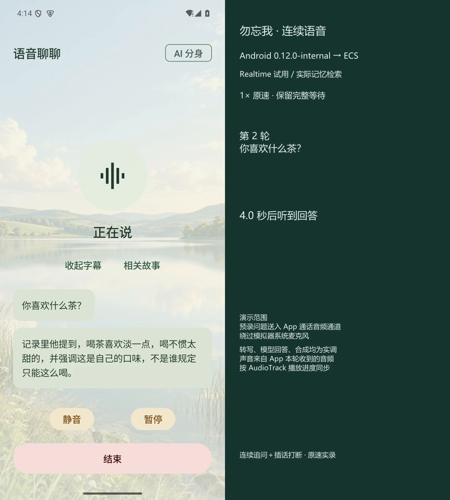

# 原速演示与结果

这些视频和图片已随仓库保存，直接下载即可查看，不依赖本机网页。它们来自 10 月 14—15 日已有试验，本次交接未重新录制；也不包含后来新增的 ASR 自动校对界面。

| 文件 | 看什么 | 等待时间与边界 |
|---|---|---|
| [Step 连续聊，1× 原速](step-realtime-1x.mp4) | 三轮问答、追问与插话；Android → ECS → Paraformer → 授权检索 → StepAudio → 播放 | 三轮实际可听等待约 5.991 / 4.024 / 3.980 秒；没有压缩等待 |
| [原路线连续聊，1× 原速](pipeline-1x.mp4) | 修复共享超时预算和 PCM 计量后，时间上最后一次完整尝试 | 等待约 3.757 / 3.879 / 2.989 秒；仍有旧状态并列的语义问题，详见报告 |
| [超时失败，未剪辑无声录屏](timeout-unedited-no-audio.mp4) | 第一次回答后，下一轮上游超时；保留失败过程 | 原始录屏无音轨，不冒充完整声音演示 |

两个带声音的成片输入是预录问题，按真实时间送入 App 数字音频通道；输出使用 App 实际收到的 PCM，按播放进度同步。是真实服务调用，**没有经过模拟器系统麦克风，不是实体扬声器回录**。不能用此证明回声、耳机或真人插话声学效果。

- [Step 计时](step-timing.json) / [原路线计时](pipeline-timing.json)
- [文件大小和 SHA-256](manifest.json)
- [完整稳定性报告](../../VOICE_STABILITY_RESULTS_2026-10-14.md)
- [Step Android 完整结果](../../STEP_REALTIME_ANDROID_2026-10-15.md)
- [记忆修订前后对照，下载后用浏览器打开](../../evaluations/memory-quality-20261015/index.html)
- [ASR 自动校对的逐段机器稿、修改与失败](../../ASR_PROOFREAD_RESULTS_2026-10-15.md)

GitHub 普通文件页不执行 HTML 报告；下载目录或克隆仓库后本地打开。19 张最初双角色截图继续保留在 [首次交接截图目录](../../screenshots/2026-10-10/README.md)，不要把历史截图当作新接口实跑截图。
