# Android 0.8.2：19张本轮顺序截图

来自本版签名APK在模拟器中的实际操作。前18张使用ECS中既有真实处理的虚构素材；第19张是明确标记的八来源布局测试，不是模型结果或八段真实音频验收。

专用账号中的两个同名故事是历史测试重复确认记录，不代表两次独立经历；本轮未删除或重写它们。原0.8.1截图和10月10日的19张流程截图分别保留。

[本版说明](../../ANDROID_GARDEN_POLISH_2026-10-11.md) · [APK与测试清单](delivery-manifest.json)

## 01 花田入口

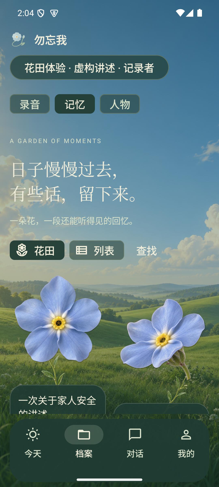

## 02 真实记忆花瓣

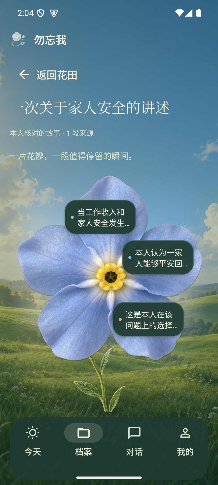

## 03 记忆与完整依据

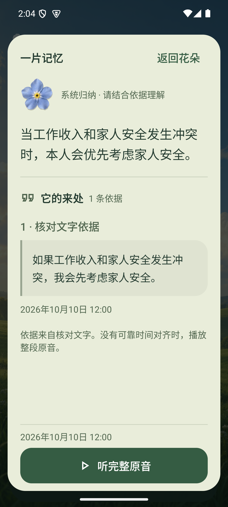

## 04 原音播放、暂停与定位

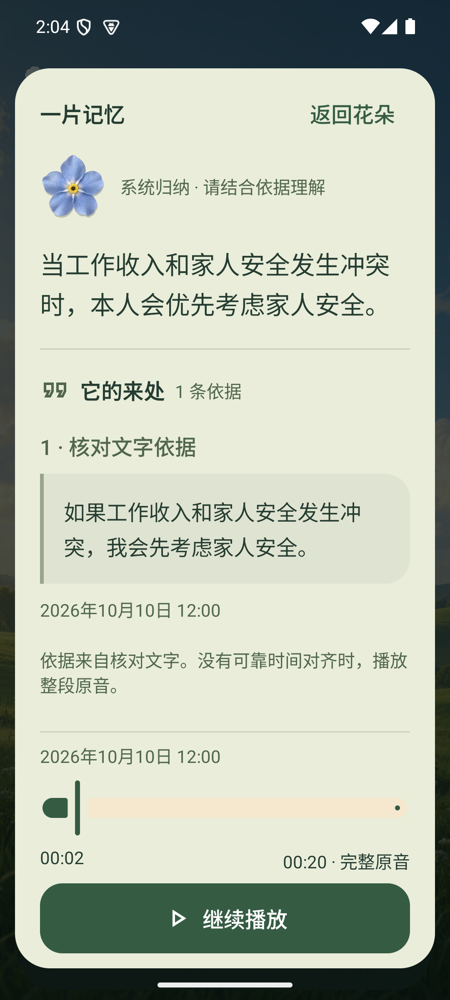

## 05 我的与设置

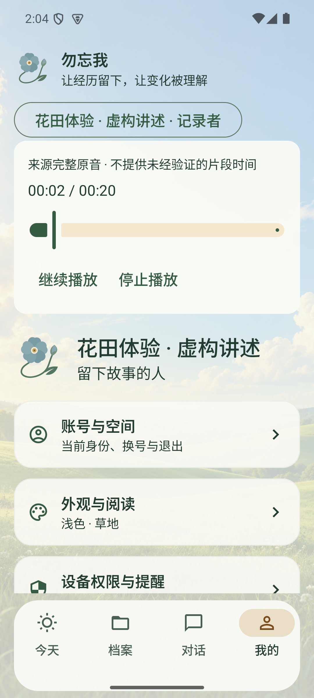

## 06 深色外观与场景预览

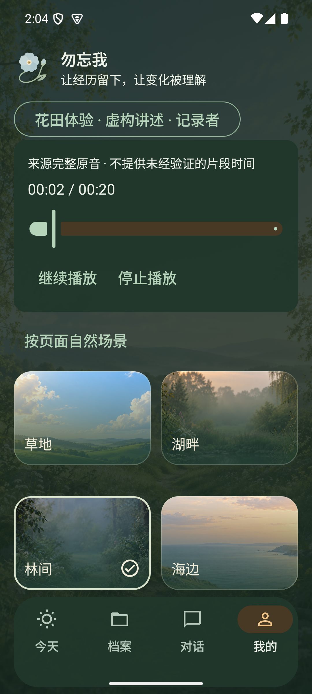

## 07 设备权限

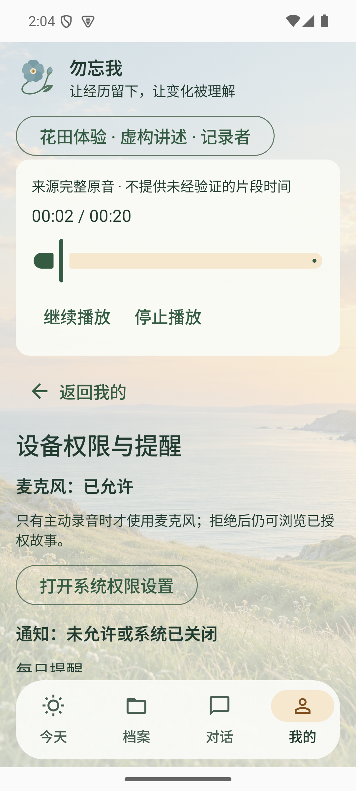

## 08 连接与缓存管理

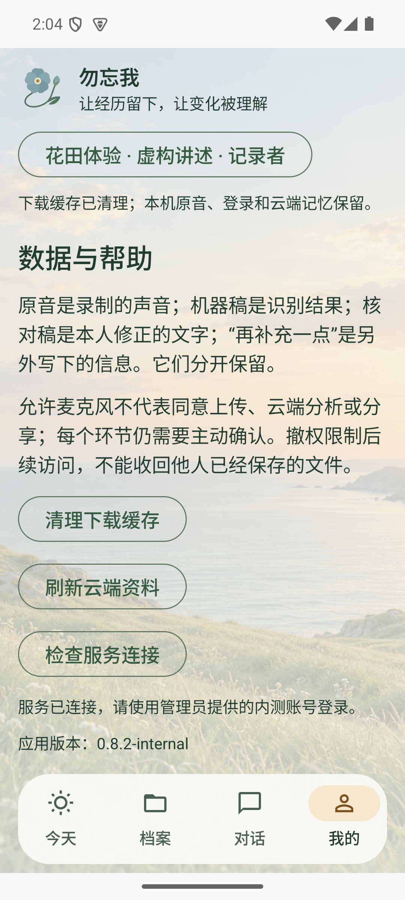

## 09 亲友授权花朵

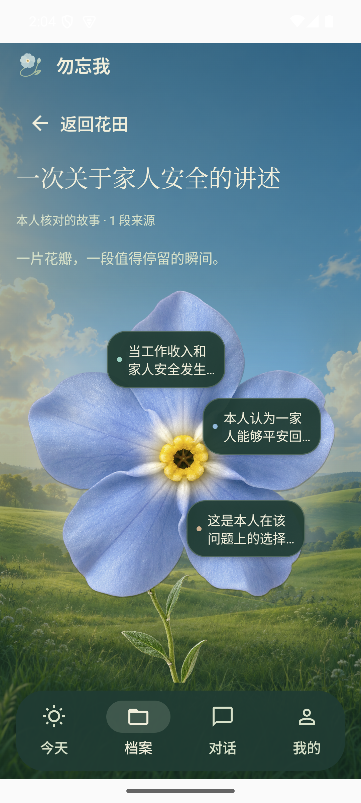

## 10 撤权后不可见

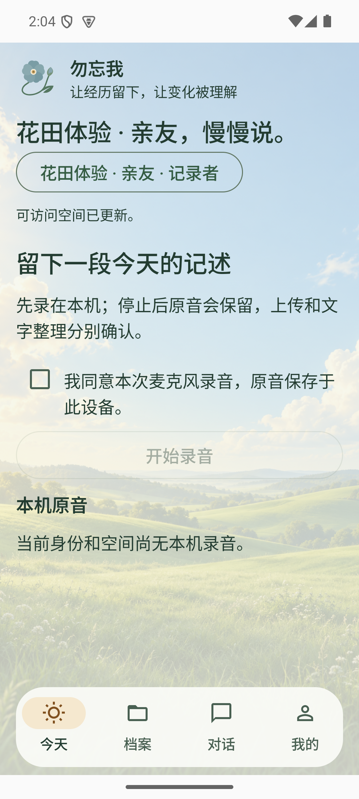

## 11 会话失效回登录

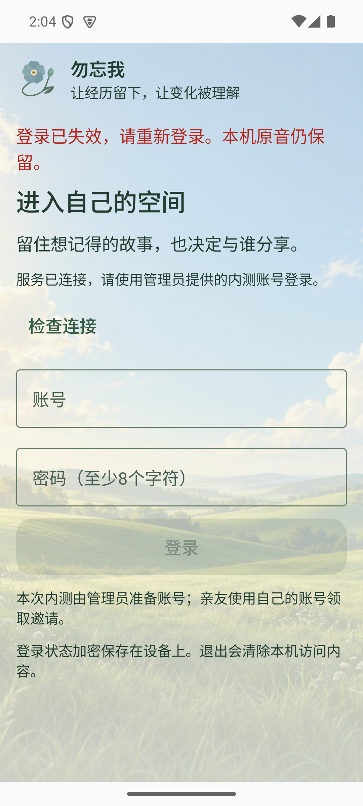

## 12 200%字号阅读

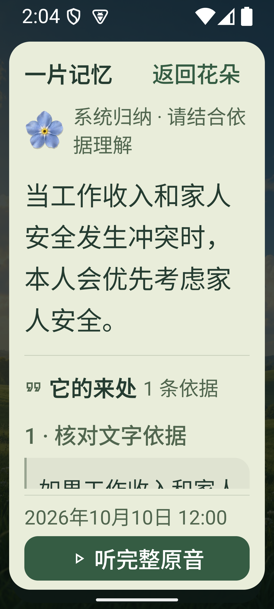

## 13 412dp花田

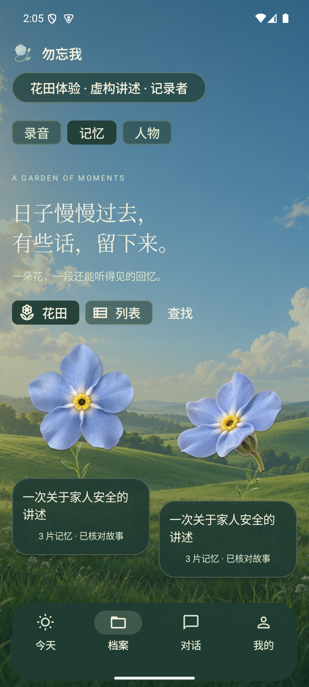

## 14 412dp花瓣

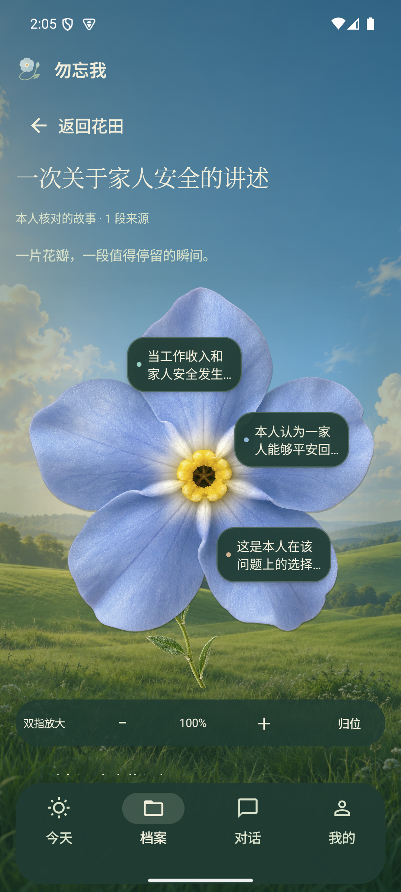

## 15 412dp记忆阅读

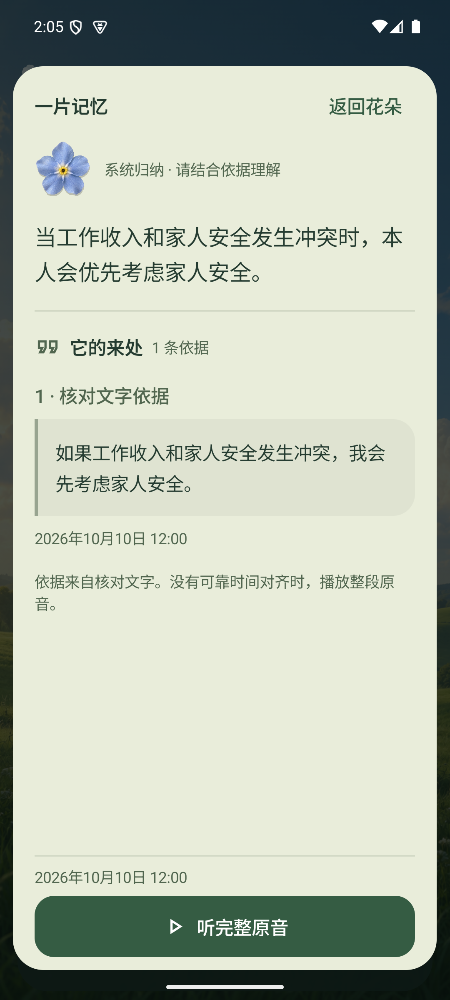

## 16 六种原稿背景预览

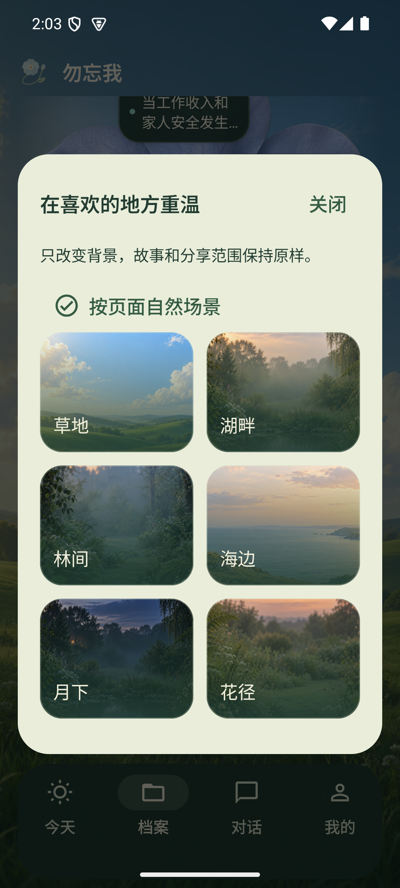

## 17 月下花田

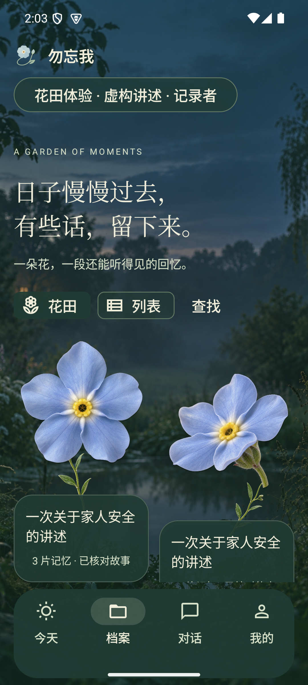

## 18 月下花朵

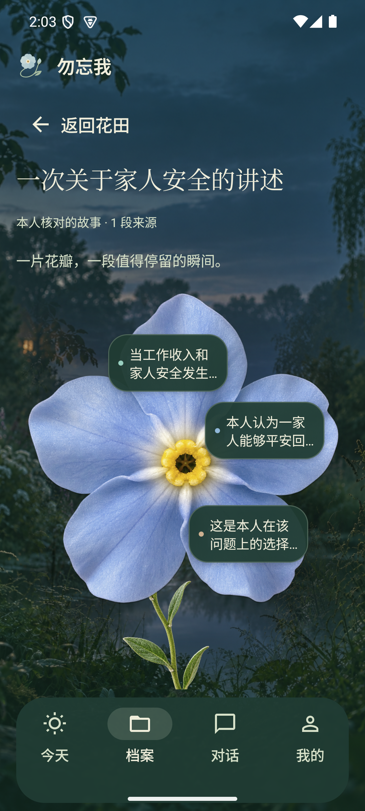

## 19 布局测试：八段来源与200%字号（非模型结果）

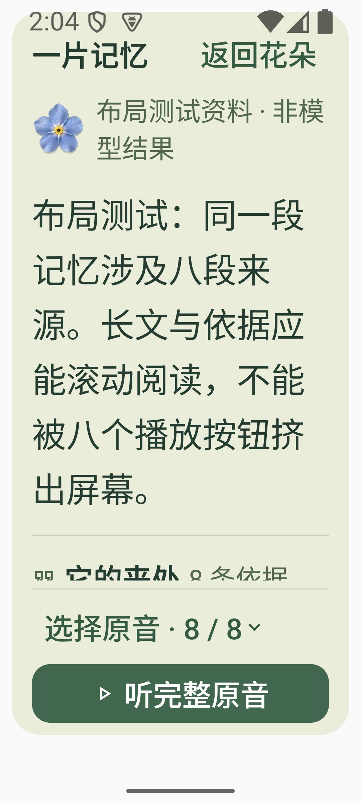
