# 0.9.1：16 张 Android 实跑截图

同一签名 APK、Android 模拟器及真实 ECS 样例数据。01–14 为正常字号，15–16 为 200% 字号；不是网页样板。13–14 是亲友账号，其余为记录者。

[安装与账号](../../ANDROID_091_QUICK_START.md) · [本次验收](../../GARDEN_NAVIGATION_ACCEPTANCE_2026-10-11.md) · [Agent 现状](../../AGENT_CAPABILITIES_2026-10-11.md)

## 01 右上角空间与角色

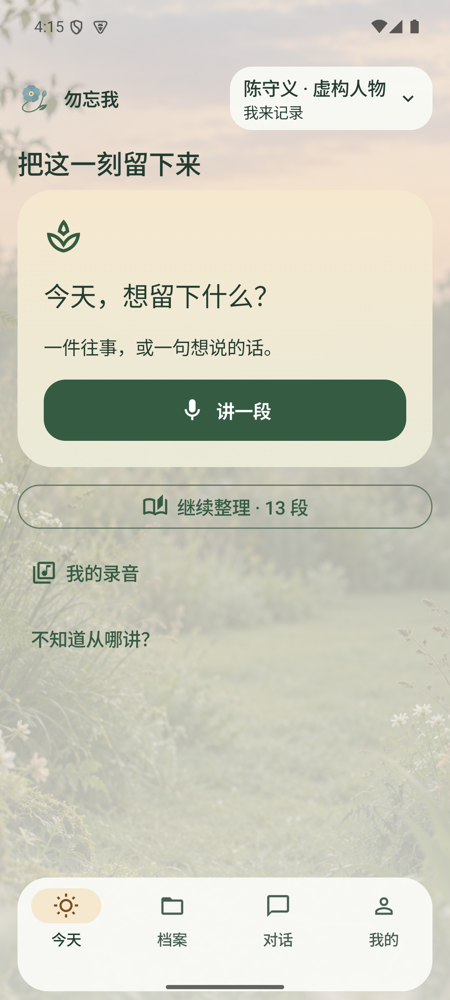

## 02 藤蔓与故事花径

## 03 固定花形与花瓣入口，无缩放条

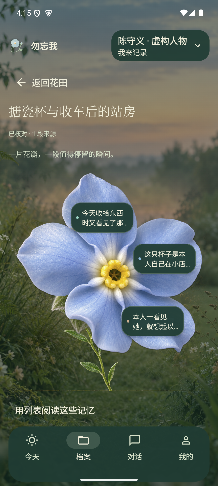

## 04 真实记忆与来源

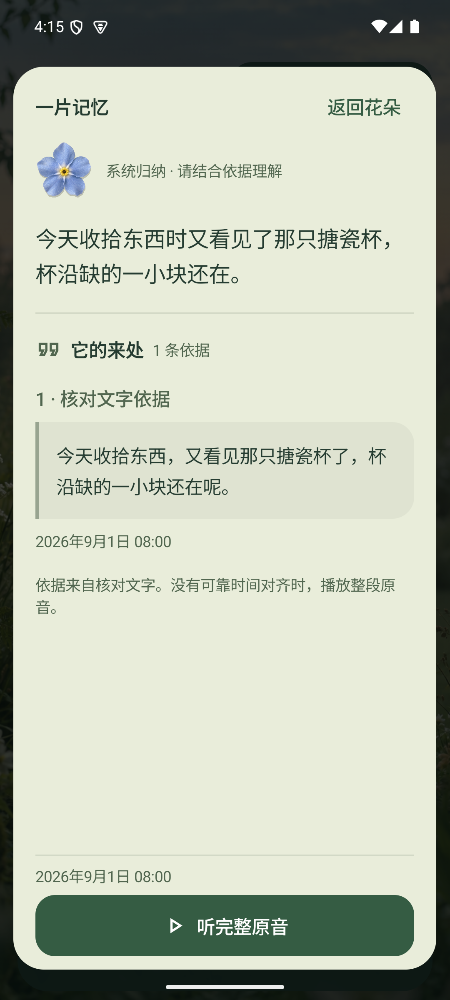

## 05 完整原音实际播放后暂停

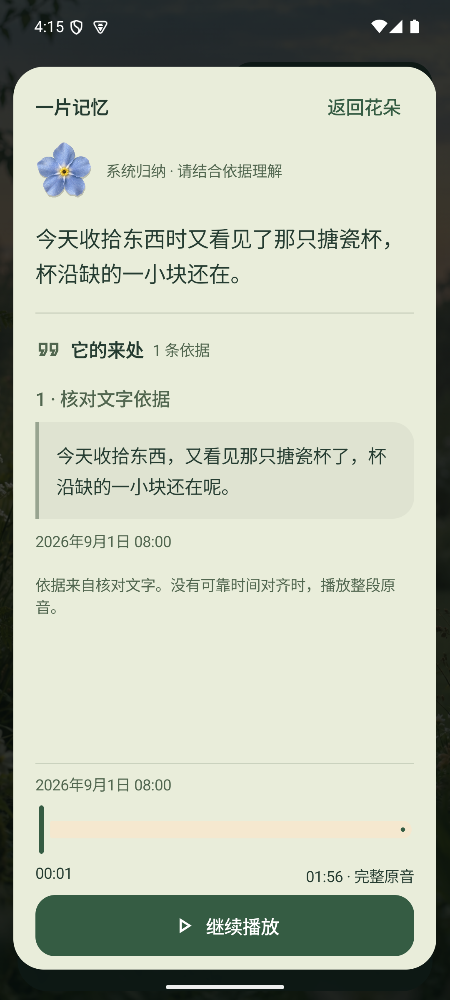

## 06 同一批故事的列表

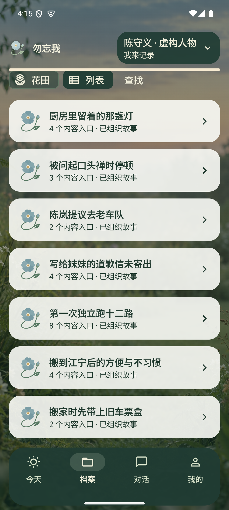

## 07 人生足迹：固定导航与单卡阅读

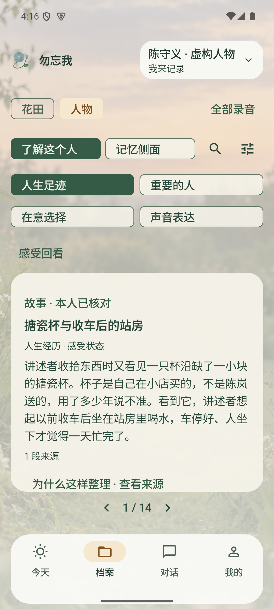

## 08 横向翻页后，在卡片内上下阅读

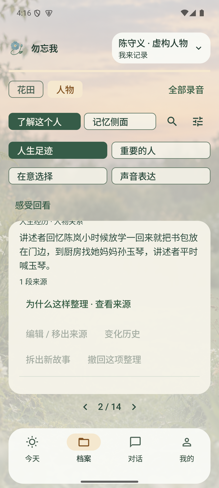

## 09 重要的人：实际人物与共同经历

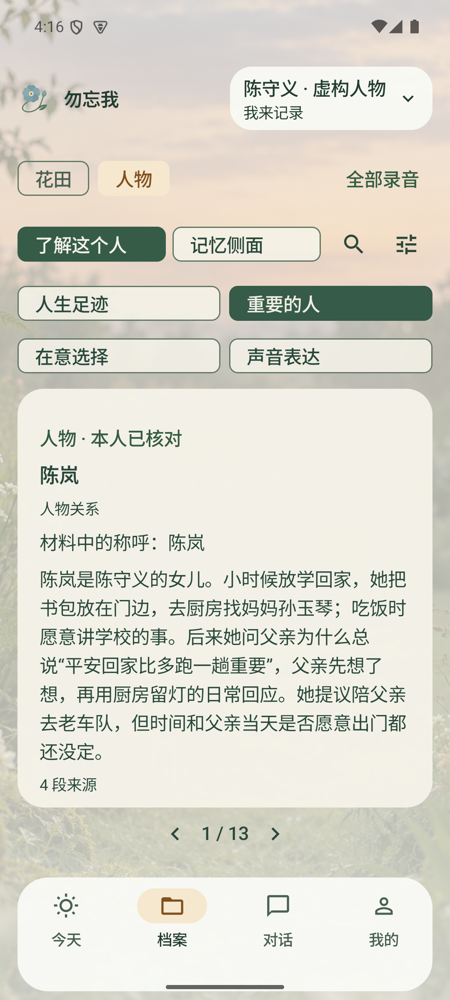

## 10 在意选择：有来源的情境观察

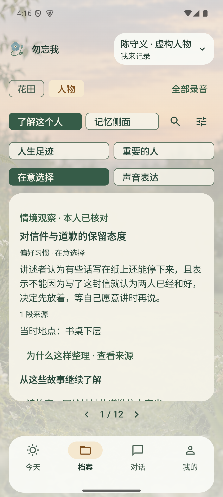

## 11 声音表达：原话与寄语

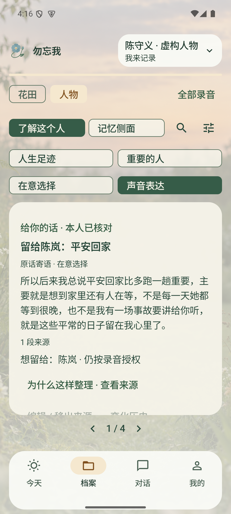

## 12 统一暖白苔绿的八侧面

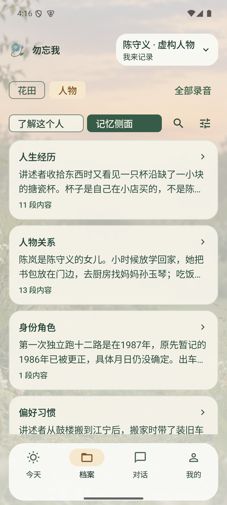

## 13 亲友也能浏览获授权花田

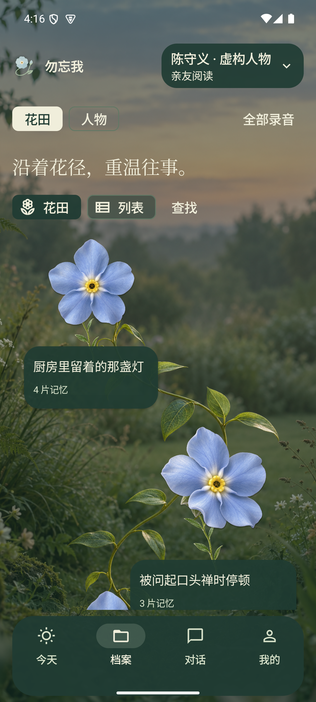

## 14 新客户端模型恢复会话及上次空间后进入花田

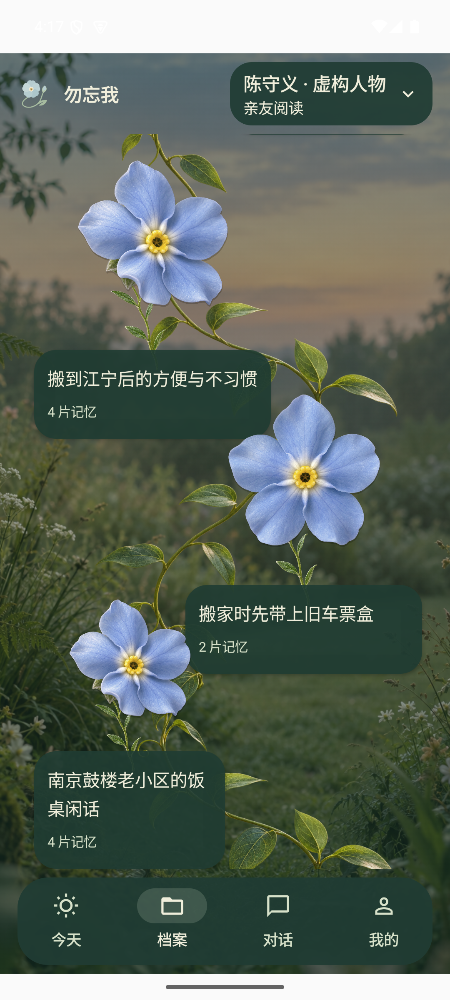

## 15 200%字号：可横向滚动的导航与独立正文

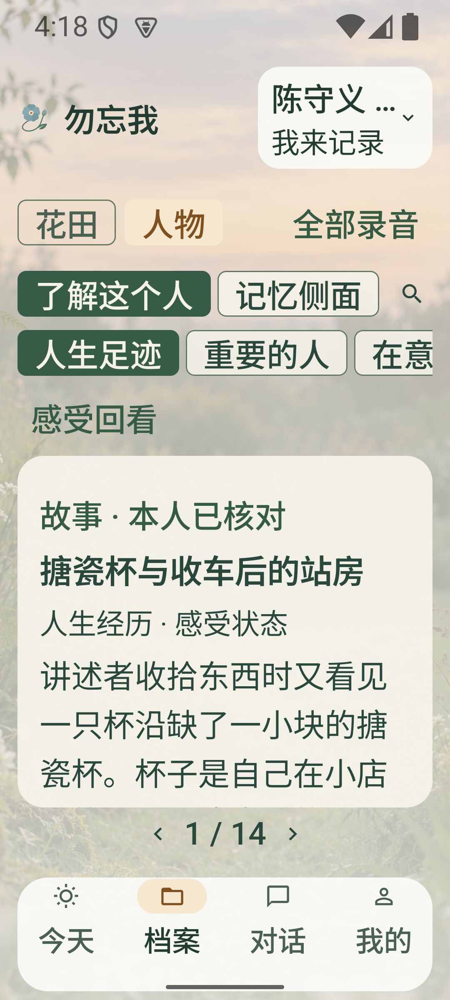

## 16 200%字号：花瓣顺序入口

