# 0.9.0：19张本轮真实Android界面

来自同一签名APK、Android模拟器和真实ECS数据。01–17为100%字号，18–19为200%。不是网页原型或界面fixture。音频为新合成素材；模拟器麦克风烟测不代表真人讲话转写质量。

[安装与账号](../../ANDROID_090_QUICK_START.md) · [验收和边界](../../IMMERSIVE_GARDEN_ACCEPTANCE_2026-10-11.md)

## 01 今天：讲一段

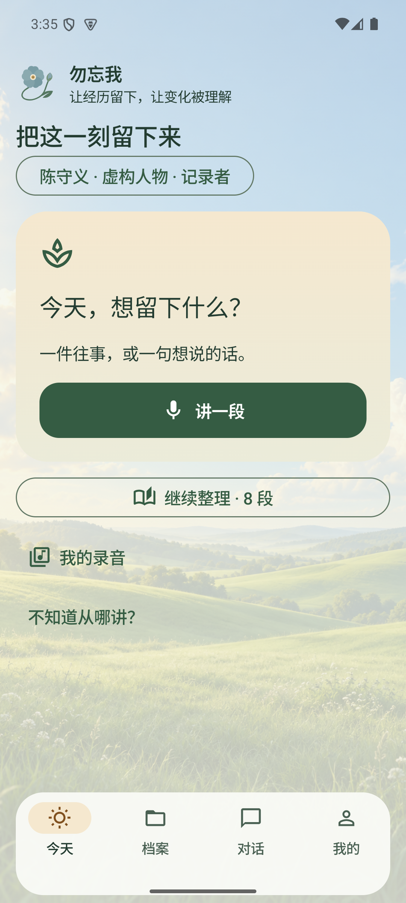

## 02 独立录音与暂停

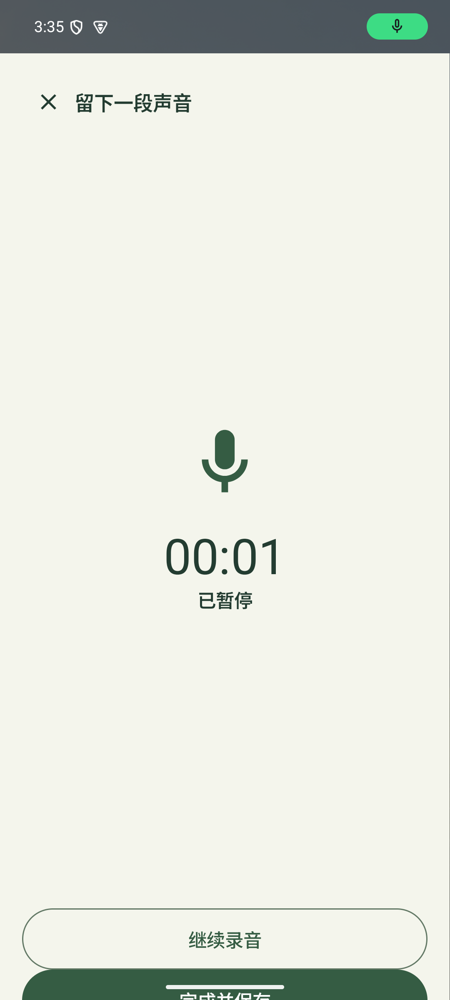

## 03 连续花径

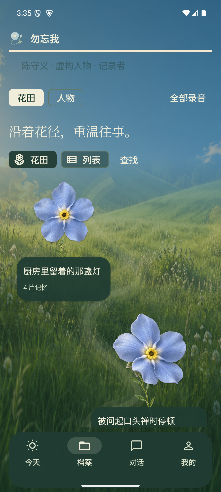

## 04 聚焦同一花形

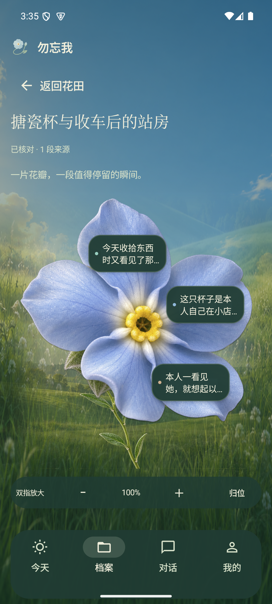

## 05 花瓣记忆与来源

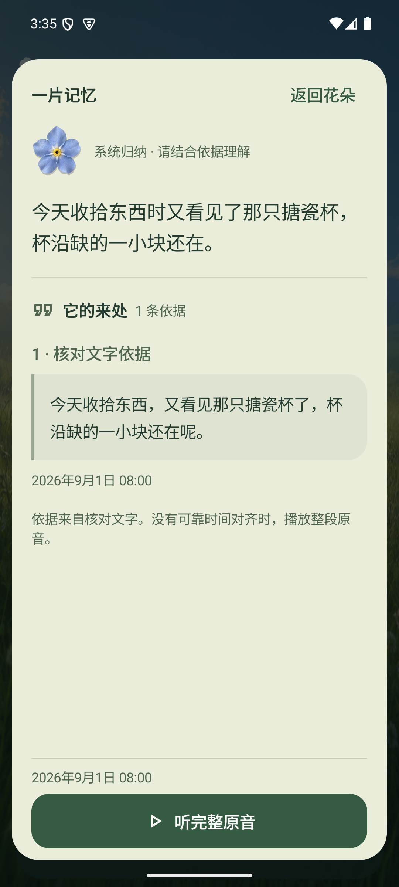

## 06 真实原音播放后暂停

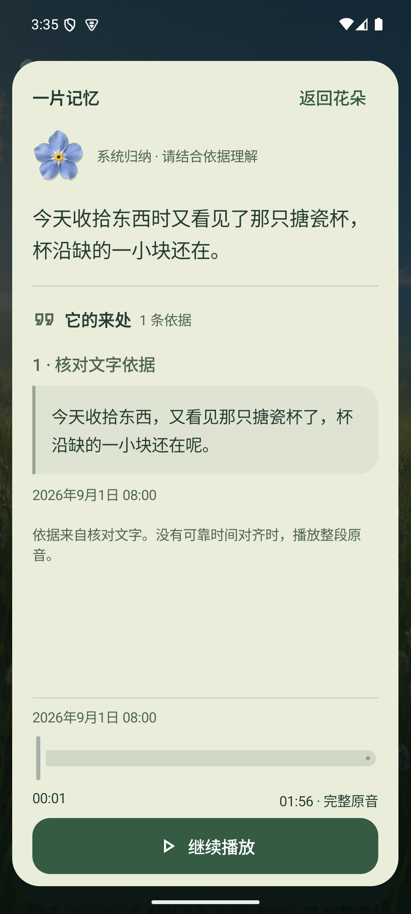

## 07 同一批内容的列表

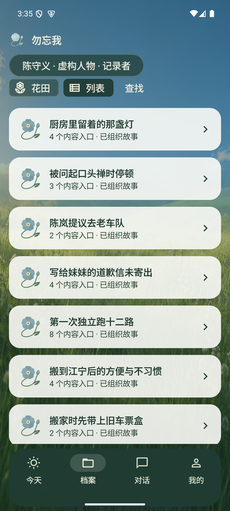

## 08 王建国：精准与相关查找

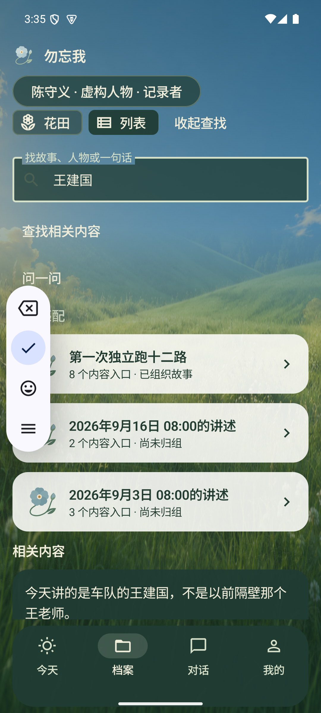

## 09 人生足迹

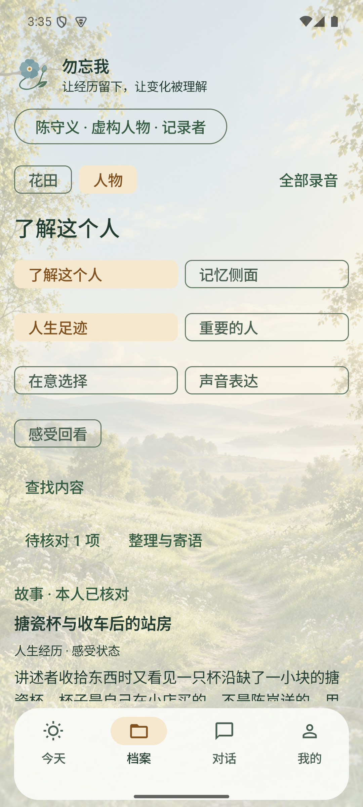

## 10 重要的人

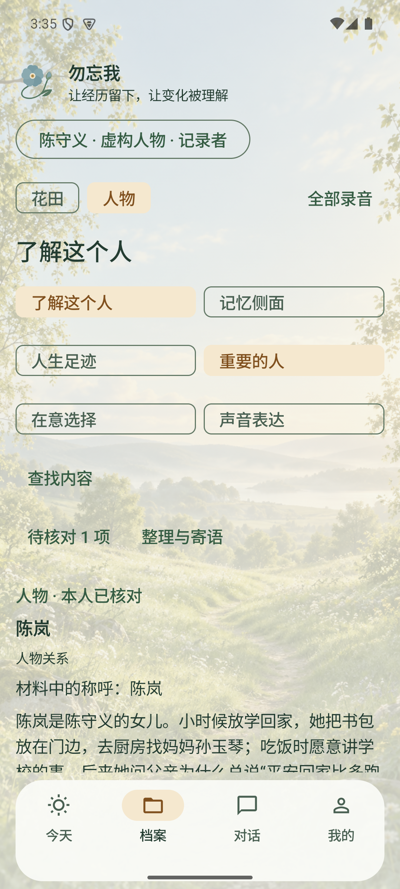

## 11 在意选择

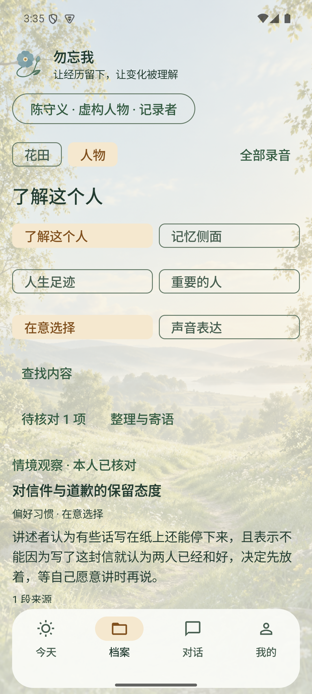

## 12 声音表达

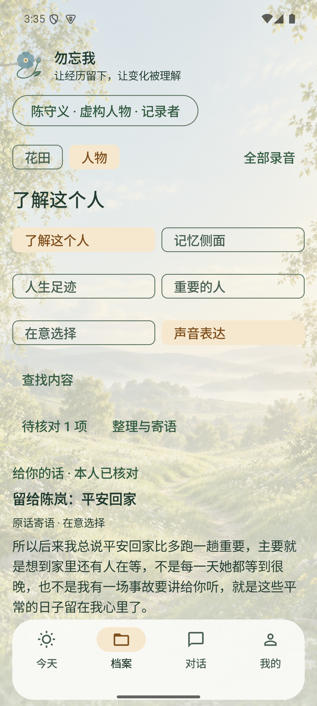

## 13 八个记忆侧面

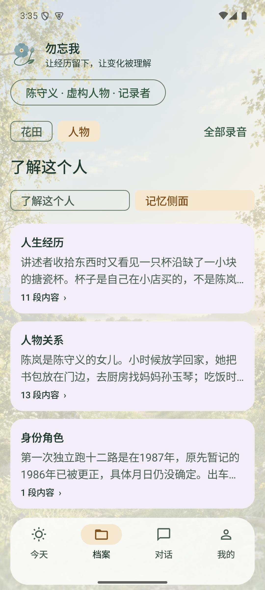

## 14 在八维总览查找人物

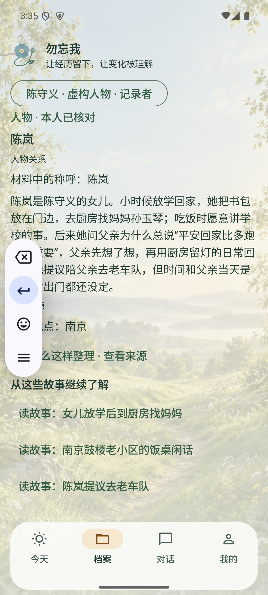

## 15 全部录音

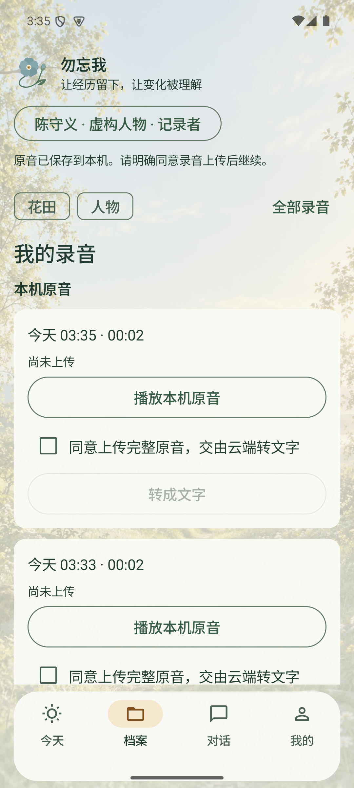

## 16 亲友的获授权花田

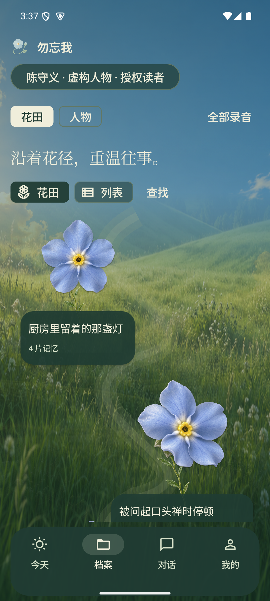

## 17 亲友的可见人物内容

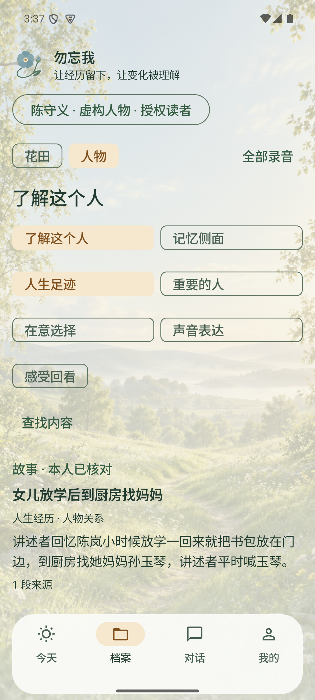

## 18 200%字号花瓣改为顺序入口

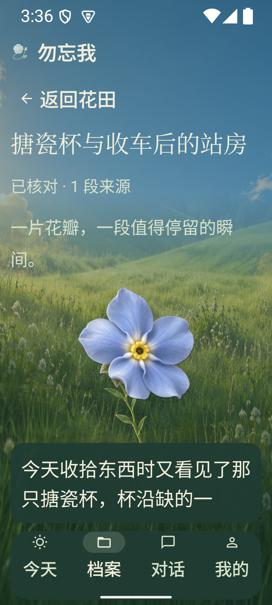

## 19 200%字号来源阅读

