# 0.9.2：13 张 Android 实跑截图

同一个签名 APK、Android 15 模拟器及真实 ECS。记录者 10 段、亲友 8 段。不是网页设计图。人物理解为虚构材料的技术复核，不是真人认可。

[安装与账号](../../ANDROID_092_QUICK_START.md) · [本次验收](../../PROFILE_ANDROID_ACCEPTANCE_2026-10-11.md) · [后台修复](../../PROFILE_VALIDITY_FIX_2026-10-11.md)

## 01 记录者首页与右上角空间

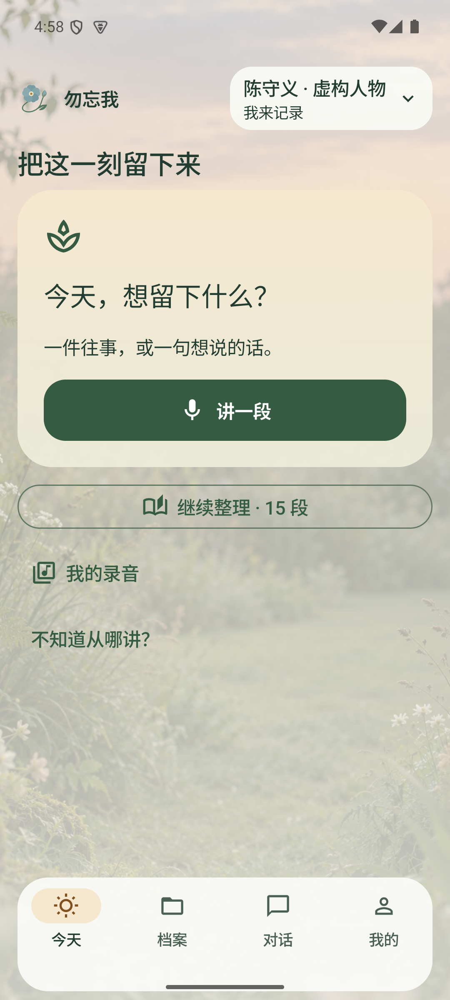

## 02 真实故事的藤蔓花径

## 03 花朵与记忆花瓣

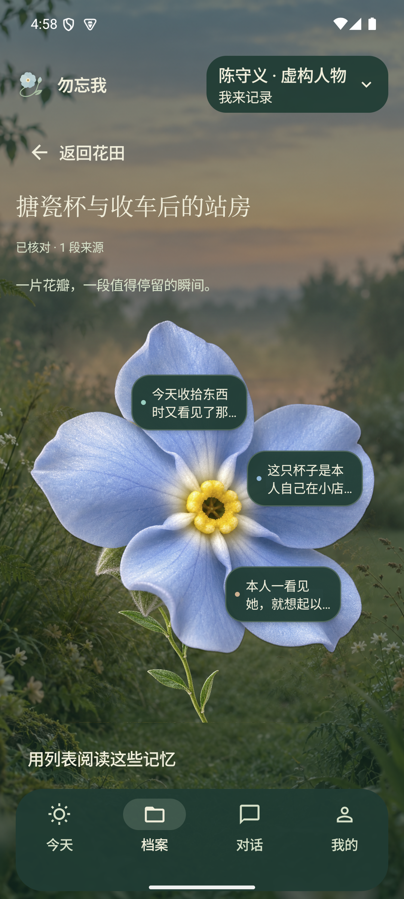

## 04 记忆与来源

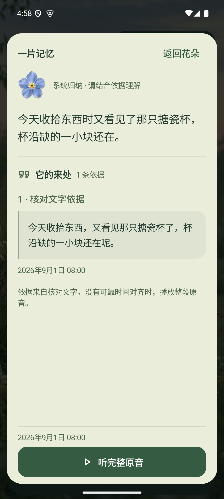

## 05 完整原音实际播放后暂停

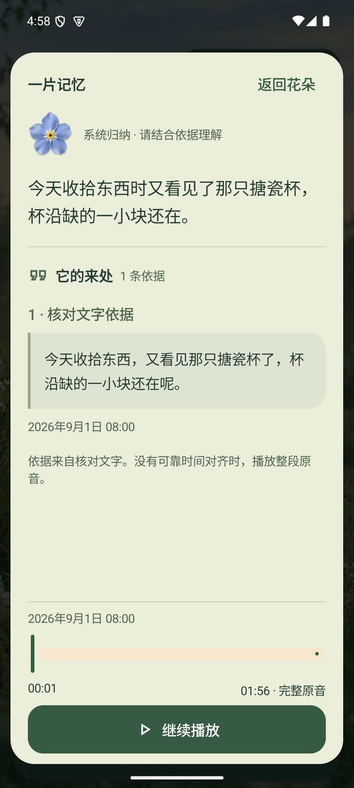

## 06 当前有效的喝茶口味理解

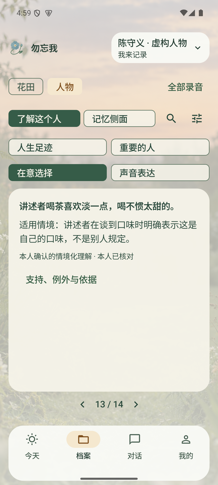

## 07 展开适用情境与原文依据

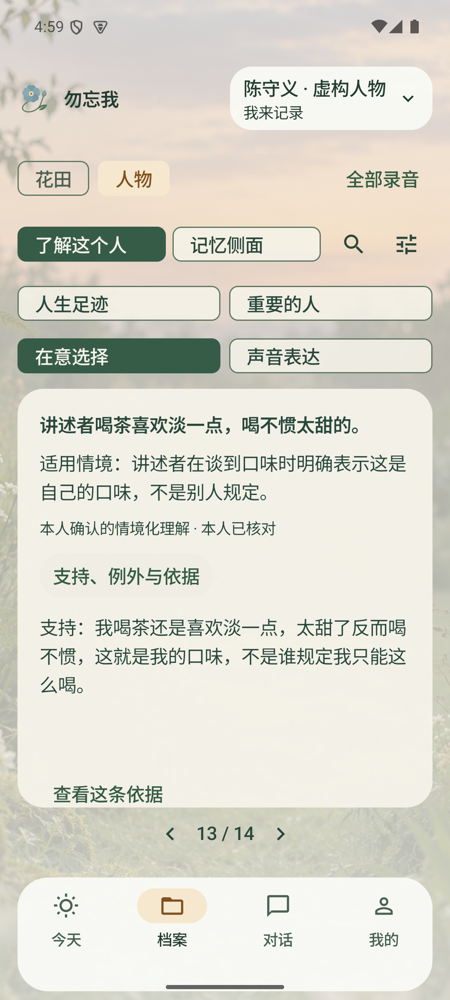

## 08 八个侧面的内容入口

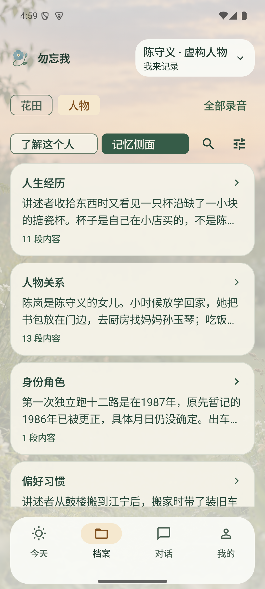

## 09 亲友访问获授权花田

## 10 重建客户端模型后恢复花田

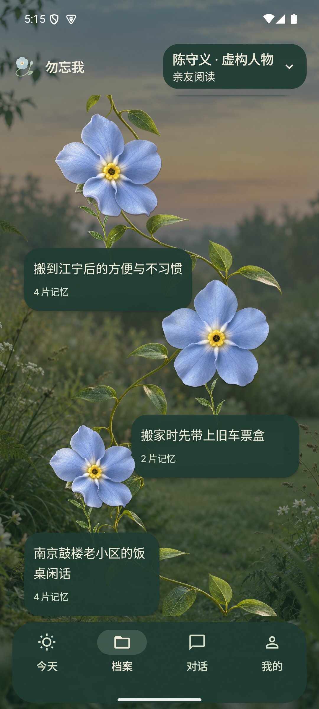

## 11 200%字号下的人物理解

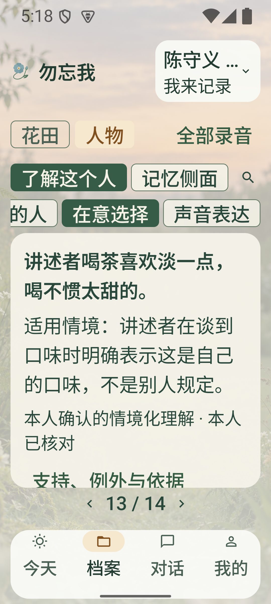

## 12 100%字号连续重建三次后的花田

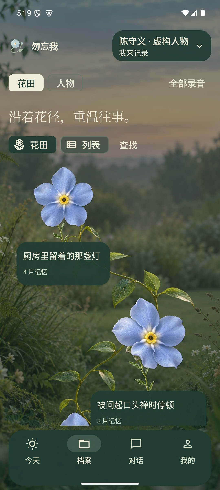

## 13 200%字号连续重建三次后的花田

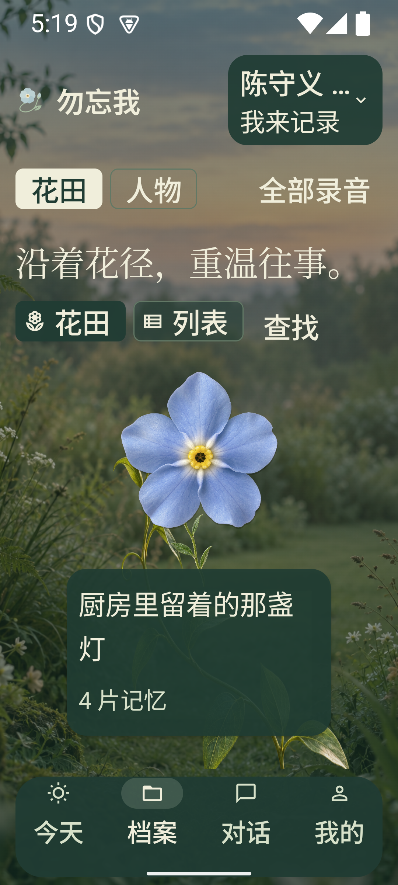
