# 简明模式 Android 实跑截图

同一签名 APK、真实 ECS，Android 15 模拟器。录音为模拟器麦克风保存检查；未用于新一轮 ASR 或模型质量验收。

[下载与使用](../../ANDROID_093_QUICK_START.md) · [范围与验收](../../SIMPLE_MODE_2026-10-11.md)

## 01 简明模式记录者首页

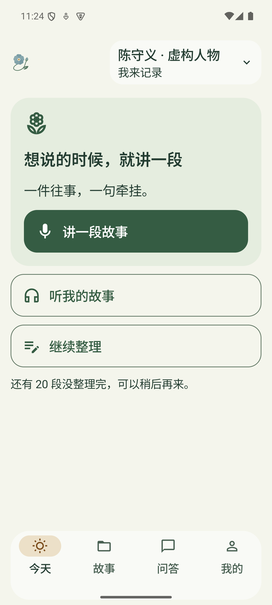

## 02 录音入口与安全区域内的按钮

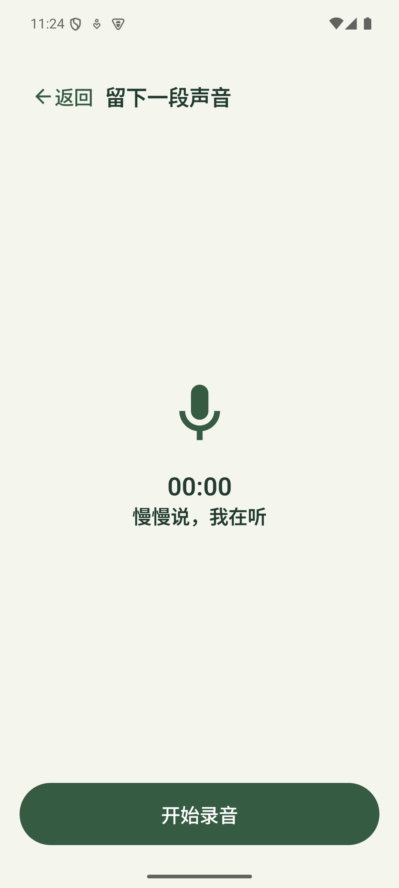

## 03 暂停后继续或保存

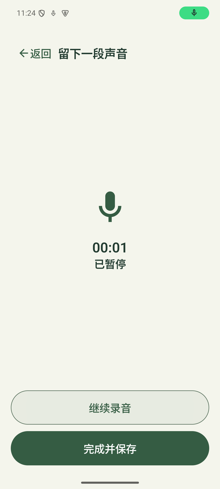

## 04 原音先保存在手机

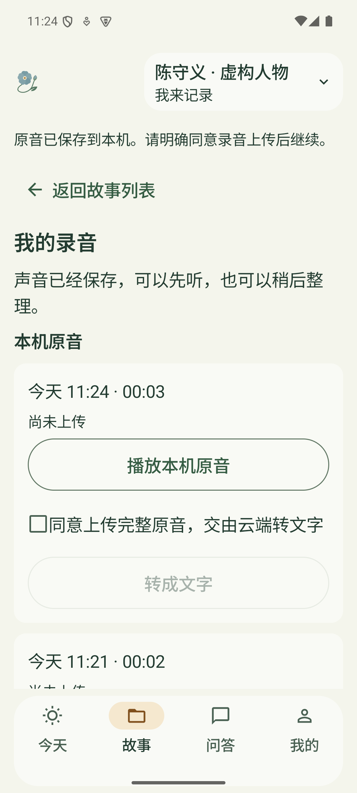

## 05 一键听真实故事原音

## 06 原音播放、暂停与重听

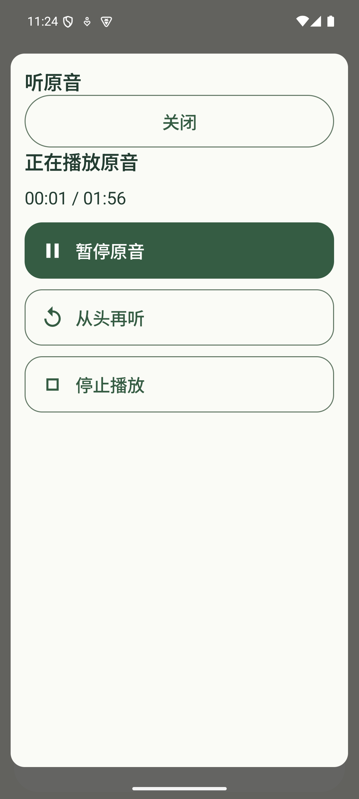

## 07 保留真实故事花田

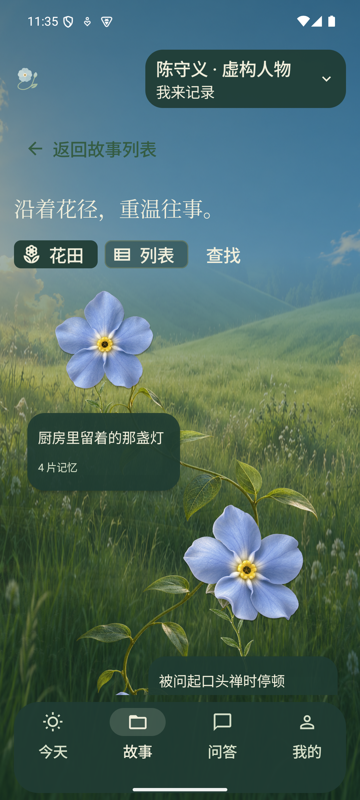

## 08 亲友简明首页

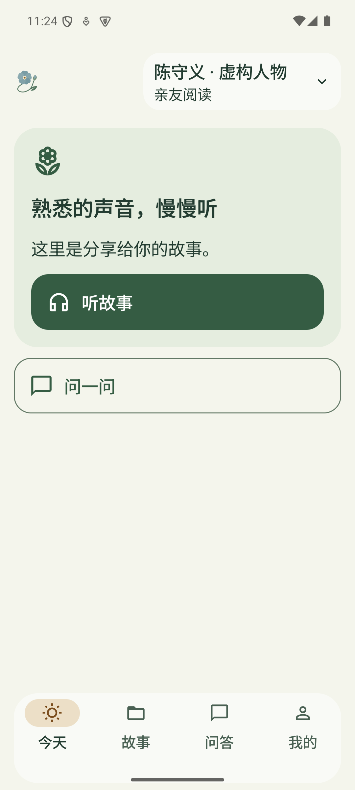

## 09 亲友获授权的故事

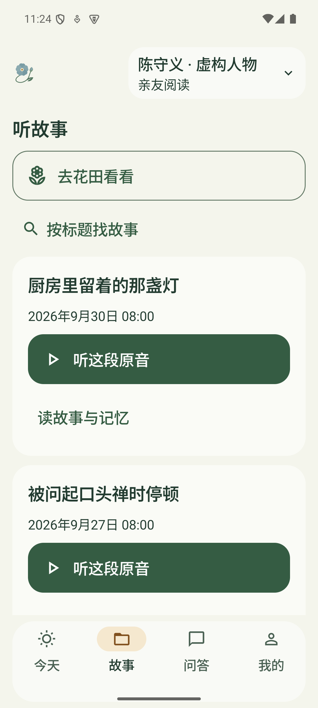

## 10 亲友来源播放

## 11 200% 字号录音入口

## 12 200% 字号完整保存按钮

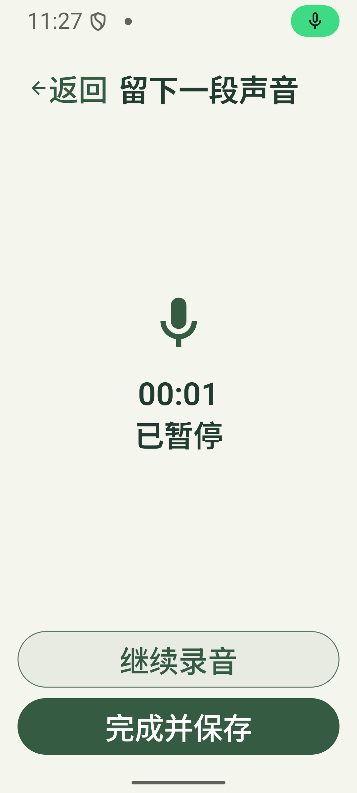

## 13 200% 字号播放控制

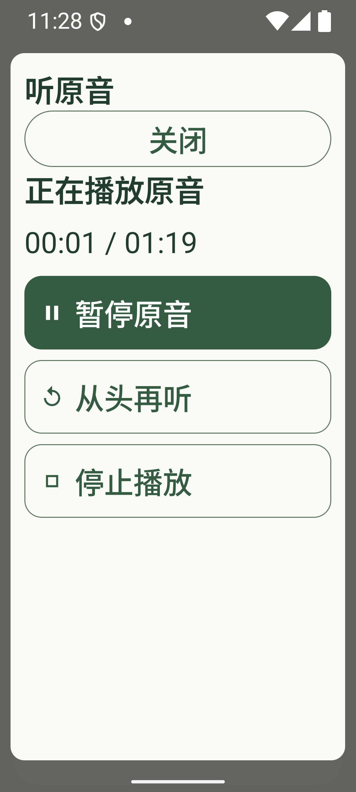

## 14 恢复完整模式

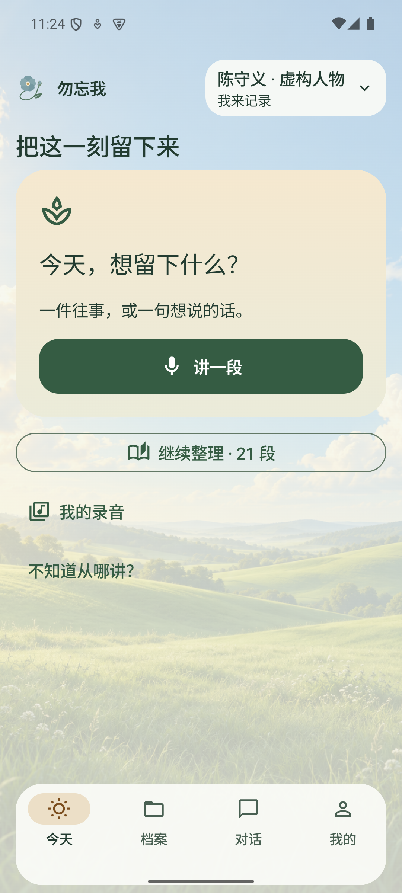
