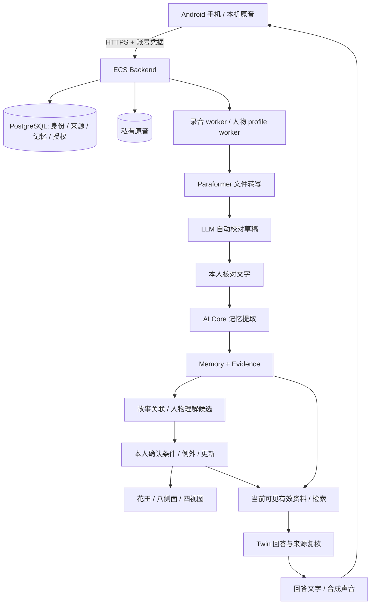

# 双端技术框架与接口对照

本文描述**当前实现与整合建议**，不是新协议已经上线的声明。Android 源码固定 `e5c037c`，iOS 后端固定 `7931dde`，生产版本另见[复盘](COMPETITION_REVIEW_2026-10-15.md)。`/api/v1` 相同不代表两个分支完全兼容。

## 1. 产品与运行架构



ECS 有 API、AI Core、录音 worker、人物 profile 四个服务。所谓多个 Agent 主要是任务职责和提示/schema 编排，不是多个自主聊天机器人互相投票。数据库与后端规则决定权限，LLM 不决定谁能读什么。

iOS 后端已经另行部署到 CloudBase：API 和 AI Core 在容器，持久任务由受保护的 tick 入口推进；声音通话由 LiveKit Agent 传输/编排，仍调用业务后端取得回答。账号、原音桶和数据库独立于 ECS，不共享 token 或原音授权。

## 2. 数据层：从原音到人物

| 层次 | 保存/生成什么 | 改错时如何处理 |
|---|---|---|
| 原始记录 Episode | 原音位置、机器转写 `stt_transcript`、核对文字 `transcript`、时间、记录者、来源类型和版本 | 原音/机器稿不被 LLM 覆盖；核对前修改听写，核对后用补充/修订关系 |
| Evidence | 对应原文区间、引文、来源类型；书面修订另有校准归属 | 引文能定位不等于语义一定正确；改动、撤权后重新核对依赖 |
| Memory | 明确事实、经历、关系、偏好等，附来源、有效状态和领域 | 被纠正条目不继续作为当前有效事实；保留 superseded 历史 |
| 故事/人物/观察/表达记录 | 可跨录音关联，八侧面、情境、依据与确认状态 | 新材料先提出关联/变更；重复经历不是新的独立支持 |
| 人物理解候选 | 表述、条件、支持、反例、时间、审核与更新关系 | 确认文字不等于确认人格；本人单独处理 ADD/SUPPORT/CONFLICT/CHANGE |
| TwinAnswer | 使用的资料版本、引用、生成模式和答案 | 来源变化后旧答案/派生声音失效；答案不回写为本人经历 |

6 类底层 Memory：事件经历、人物身份、人物关系、偏好习惯、价值看法、感受情绪。7 个领域：身份认同、经历记忆、人际关系、偏好习惯、价值信念、决策方式、表达方式。8 侧面是展示维度，4 视图是组合方式，**不是分四轮生成四个人格**。

| 八侧面枚举 | 展示名 | 四视图组合 |
|---|---|---|
| EXPERIENCE | 人生经历 | 人生足迹 |
| RELATIONSHIPS | 人物关系 | 重要的人 |
| IDENTITY | 身份角色 | 人生足迹 |
| PRACTICES | 偏好习惯 | 在意选择 |
| VALUES | 在意选择 | 在意选择 |
| FEELINGS | 感受状态 | 人生足迹 |
| WISHES | 愿望牵挂 | 在意选择 |
| EXPRESSION | 原话寄语 | 声音表达 |

一次材料可命中多侧面，不为填满花瓣生成新内容。Android 映射实现在 `integration/MemoryMap.kt`，有有效来源且已确认的记录才进入正常浏览，候选另列。

### 自动校对到底是什么

在 ASR 后调用 LLM 的一次独立文本判断工序；不是再次听原音，也不是声纹识别。`services/ai-core/app/transcript_correction.py` 的提示要求保留口语、否定、条件、时间、主体与原有信息量，输出 before/after/category/action/reason。仅确定的词语/标点可自动应用；姓名、数字、归属、含义变化等留下 `review` 建议。

后端校验输入 SHA、每项修改的位置与原文、修改是否重叠、自动类型与重建草稿是否一致。非法/超时结果不应毁掉机器稿，也不再重复 ASR。自动校对存在误判可能，完整记录供本人恢复与核对。此路已接 **新上传的本人文件转写**；没有接所有实时字幕、亲友补记或旧记录批量重写。

跨端迁移时，除了复制提示词，还要迁移后端验证、政策回执、原始稿字段、核对页和失败恢复。声纹只表示“声音可能是谁的”，不能证明这段文本中的“清福”没有错字。

### RAG 与人物理解怎样参与回答

先按 Actor/Subject/有效授权过滤，再选当前有效文字、修订、已确认理解和完整相关依据。Android 普通文字默认 `retrieval_mode=full`，可选 `local`；BGE 中文向量与文字匹配负责找资料，不负责判真伪。语音有准备缓存、选择预算与预取代码；**当前 ECS 预取开关关闭**。队友 RAG 可接适配边界，但不能直接返回未经本项目校验的引用给用户。

iOS 分支增加 `evidence_rag.py` 和证据块向量持久化，另有 `chat_memory.py` 与 `previous_answer_id`。聊天历史可帮助理解追问，不能因它曾经说过就成为原始事实。单轮预算应控制选入材料，不能要求用户撤销分享才能回答。两边的检索质量均需要具体问题和人工相关性检查；向量相似度不是事实正确率。

## 3. 身份、权限与更新必须共同保留

- `Actor` 是登录操作者；`Subject` 是被记录的人。同名、声纹标签、设备 ID 都不能替代账号身份。
- 登录 Bearer 凭据由服务端校验，不向客户端提供模型 Key。ECS 与 CloudBase 的 Actor/Subject/Consent ID **不可互用**。
- 分享按完整 Episode 原音/文字范围预览，邀请领取不立即授予阅读；本人批准后生效。新增录音不自动扩大旧分享。
- 阅读授权和允许云端问答是不同判断；只有浏览资格不能绕过模型使用许可。
- 亲友理解须保守检查全部支持、例外、变化都可见；不能复用完整私人画像。
- 亲友补记保留作者、亲历/转述/看法及单独模型使用许可；本人接受不是改作者为本人。
- 新增、纠正、后来变化分开；先阻止旧事实继续用于新答案，再提出受影响理解的复核。拒绝人物候选本身不能修好原始错字或底层错误 Memory。
- 生成前、生成后、播放和恢复前台再次检查来源/权限；旧结果迟到不进入新身份或新轮次。撤权不能远程抹掉别人已经看见或保存的内容。

## 4. HTTP 接口实际差异

以下 `S` 表示 `/api/v1/subjects/{subject_id}`，`W` 表示 `/api/v1/workbench/subjects/{subject_id}`。路径有相同项不代表所有响应字段等价；全部声明与文件行号见 [扫描 JSON](evidence/2026-10-15/platform-scan.json)。

| 任务 | Android/ECS | iOS 后端 | 适配要点 |
|---|---|---|---|
| 版本 | `GET /api/v1/service-info` | 同地址 | API 版本不同；不要按版本数字自动认为所有功能兼容 |
| 登录 | `POST /api/v1/accounts/login`，`GET /api/v1/session` | 保留同源账号接口 | 使用各自环境账号；注册都关闭 |
| 文件录音 | `POST /api/v1/episodes` multipart | 同源基础 | `source/recorded_at/metadata/consent/idempotency` 按各端约定；不要复制本地 DB |
| 核对稿 | `GET/PATCH /api/v1/episodes/{id}/transcript-review` | 同源基础 | ECS 新增 raw machine/automatic correction；iOS 类型暂没有 |
| 结果/原音 | `GET /api/v1/episodes/{id}/result`、`.../audio` | 同源基础 | 每次鉴权，不把旧 URL 当永久凭证 |
| 故事/人物 | `GET W/narrative`，`W/profile-candidates` 等 | 有共同早期基础与新增覆盖接口 | 来源有效性与确认状态须统一，不只统一卡片名 |
| Twin | `POST S/twin/answers` | 同地址，输入已分叉 | 必须显式映射，见下方 |
| 连续语音能力 | `GET /api/v1/voice-capabilities` | `GET S/twin/voice/capabilities` | 作用域、policy 和输出结构不同 |
| 连续语音创建 | `POST S/voice-sessions` | `POST S/twin/voice/calls` | WSS vs LiveKit |
| 连续语音结束 | `DELETE /api/v1/voice-sessions/{id}` | `DELETE S/twin/voice/calls/{id}` | 调服务端结束，再清本地媒体与迟到结果 |
| 亲友补记/信件 | `W/companion/...` | 没有同一组 companion 路由 | 不能用多人录音接口替代补记授权 |
| 声纹/发言人 | 发布版没有 | `S/voice-identities`、`S/speaker-recordings` | 可选能力；默认聊天不依赖识别成功 |
| 托付 | 指定信件/只读快照 | `S/entrustments`、`/api/v1/entrustments/...` | 密语/照护人/解锁不能假映射成分享按钮 |
| SDK 临时会话 | 主 App 未接线 | `POST S/recording-device/session` | 厂商长期 Key 不进两端；SDK 二进制单独准备 |

同题 Twin 请求示例（占位符必须用本环境真实授权替换；示例无凭据）：

```json
{"question":"茶要浓还是淡？","cloud_consent_id":"<consent>","mode":"persona","retrieval_mode":"local"}
```

上面是 ECS。iOS 后端是：

```json
{"question":"茶要浓还是淡？","cloud_consent_id":"<consent>","conversation_mode":true,"previous_answer_id":"<previous-answer>","request_id":"<unique-request>"}
```

第一次对话省略 `previous_answer_id`。两个模型均禁止多余字段；本次已在两个真实 Pydantic 类型上复现字段互换拒绝。不能简单把 `mode="persona"` 译成 `conversation_mode=true`：前者强调使用已确认人物理解，后者还涉及连续对话、历史及第一人称路线。

**建议而非已实施：**客户端统一业务接口 `askEvidence / askPersona / startVoice / inspectSpeakers`，环境适配器负责当前 wire payload；新增 capability 标识与跨端 schema 应先评审。旧地址和旧 payload 保持可用，避免同时强制升级所有已装客户端。不要删除 `extra='forbid'` 来掩盖模式差异。

## 5. Android 连续语音协议

1. 登录后查询 `/api/v1/voice-capabilities`。`enabled` 取决于测试名单；input `pcm16le/16000/1`，output `pcm16le/24000/1`。引擎和 `response_speeds` 按响应选择。
2. `POST S/voice-sessions`。完整最小示例：

```json
{"cloud_consent_id":"<consent>","mode":"evidence","policy":"continuous-voice-v1","cloud_asr_allowed":true,"cloud_tts_allowed":true,"response_speed":"reviewed","engine":"pipeline","purpose":"dialogue","simple_mode":false}
```

3. 返回 `session_id / websocket_path / protocol / expires_in`。连接同一 HTTPS 主机的 WSS，**Authorization Bearer 放 header**；当前服务拒绝 query 参数传凭据或重复使用同一会话连接。
4. 等服务端 `ready` 再采集。输入为二进制 PCM 块；JSON 控制为 `interrupt`、`playback`、`pause`、`resume`、`end`。
5. 服务端事件带 `session_id` 与 `turn_id`：`transcript`、`turn_started`、`answer_ready`、`audio`、`audio_end`、`interrupted`、`paused`、`error`。音频事件使用 base64 PCM、序号及采样信息，实际字段以 `voice_turns.py` 为准。
6. 客户端按 AudioTrack 实际播放帧回报 `{"type":"playback","turn_id":1,"samples":24000}`，不是按“已收到多少”回报。旧轮次包直接丢弃；只把已完整播放的句子放进后续对话上下文。
7. 插话本地先停声/清缓冲，再通知取消；服务端递增轮次、取消旧任务并丢迟到答案。切后台、耳机变化等暂停，结束时清媒体与服务器会话。

`reviewed` 保留独立语义审阅；`fast`/`streamed` 是用户已同意的提速试验，保留权限、版本和结构保护，但跳过阻塞的大模型审阅。Android“快速回复”在服务器支持时映射到 `streamed`；Step 必须 `engine=step_realtime, response_speed=fast, purpose=dialogue`。**Step 目前仍由 Paraformer 先识别，再发送文字与记忆到 StepAudio；不是 Step 原生全音频接管。**

通话登记保存在当前 API 进程内，不能未经会话路由/共享状态设计直接横向扩为多个 API worker。当前代码有音频准备/缓存和超时预算，但上线预取关闭；Smart Turn 也不是默认已部署能力。

## 6. iOS LiveKit 与声纹路线

客户端查询 `S/twin/voice/capabilities`，获取当前动态 `policy`；创建 calls 需 `cloud_consent_id`、独立 `voice_consent_id`、`policy`，可选 `voice_mode=default/personal`。自然采集另带录音与说话人识别许可及 `enroll_owner_voice`，不能用声音授权替代。

服务端创建持久 `VoiceCall`、返回 LiveKit URL/短时房间 token/参与者身份。手机客户端加入房间，Agent 通过仅服务间可用的 `/internal/voice-calls/{call_id}/...` 调用授权、listen、answers、speech、interrupt、utterances、turn-complete。**这些 internal 端点不是手机应直接调用的 API**，其凭据不进入 App。

声纹数据链：

```text
明确本人登记 → 清晰介绍 → 后端声学向量 → Subject 内模板
后续发言原音 → Paraformer 分段 → 非重叠/有可靠时间的片段
→ 同模型向量匹配 → 本人 / 其他人 / 未知
→ 只有满足本人归属与许可的片段进入自然采集模型任务
```

`voiceprints.py` 使用 `sherpa_onnx.SpeakerEmbeddingExtractor`，适配 WeSpeaker 中文模型。声音克隆是 CosyVoice profile，声纹是 VoiceIdentity；二者模型、目的、授权与删除不是同一资产。名字是自述标签，匹配不是登录认证；密语仍要正确账号/计划/范围才能使用。

在现有实现中，声纹失败可以继续聊天；自动归属不足的材料不应进本人模型。模型文件存在不等于实际可编码，合成语音的同声/异声测试不等于真人准确率。ECS 目前没有部署这个模型或这些路由。

## 7. 数据库与发布合并规则

共同祖先 `a12354aedb8c34d4660e3c0274c77d6133930663`。完整迁移名见扫描 JSON。双方从 `0016_share_invitations` 分叉，这不是单纯“iOS 0024 比 Android 0021 新，直接升级就行”。

在隔离库完成以下动作后才能切换统一服务：

1. 导出两套现有 schema/迁移 head 清单与脱敏行数；备份各自原音/数据库/配置，验证恢复。
2. 在集成分支逐模块解决模型定义和约束，保留已经执行过的 migration ID，不重写旧迁移。
3. 设计显式 merge migration/必要的数据转换；分别从 **ECS 副本、CloudBase 副本、空库** 运行并验证。pgvector、授权 scope、TwinAnswer 和人物字段差异都需考虑。
4. 如果迁入同一实例，制定 Actor/Subject/Consent/来源 ID 映射；不能按相同用户名认定是同一个人，不能只拷贝 Memory 丢掉 Evidence/原音/授权。
5. 旧客户端回归：录音、核对、人物、两种问答、双方共享、补记与撤权；再验证新语音/声纹。
6. 备份、候选发布、就绪、有限账号冒烟、同签名 APK/独立签名 iOS、可回退记录。回退应用不覆盖数据库、不删原音。

当前 Android internal APK 信任特定 IP 测试证书；iOS CloudBase 使用其正式域名与 TLS。不能关证书校验“修复”互连。API release、APK hash、iOS build、schema/migration、功能开关、测试范围必须一同记录。

## 8. 实现索引

Android：`NativeWorkbenchModel.kt` 编排；`BackendClient.kt` HTTP；`VoiceCallEngine.kt` 媒体；`MemoryGardenScreen.kt / NarrativeScreen.kt / CompanionScreen.kt` 展示。均在 `apps/android/app/src/main/java/me/remember/app/integration/`。

ECS 后端：`app/api/episodes.py`、`app/transcript_correction.py`、`app/materials.py`、`app/rag_contract.py`、`app/api/twin.py`、`app/api/voice_sessions.py`、`app/voice_turns.py`、`app/api/profiles.py`、`app/api/companion.py`，目录根为 `services/backend/`。

iOS 分支请使用固定 SHA 的文件，不能在 Android 分支按同名文件推断：[声纹](https://github.com/ztjklt/Remember-Me/blob/7931dde6413466fb5d67021d342f2824cb0604e5/services/backend/app/voiceprints.py)、[发言入库](https://github.com/ztjklt/Remember-Me/blob/7931dde6413466fb5d67021d342f2824cb0604e5/services/backend/app/voice_utterances.py)、[实时 API](https://github.com/ztjklt/Remember-Me/blob/7931dde6413466fb5d67021d342f2824cb0604e5/services/backend/app/api/realtime.py)、[LiveKit Agent](https://github.com/ztjklt/Remember-Me/blob/7931dde6413466fb5d67021d342f2824cb0604e5/services/realtime/agent.py)。
