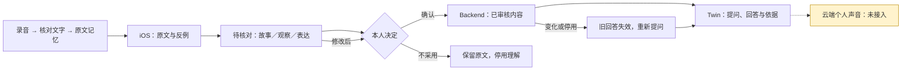

# iOS：核对理解，再交给 Twin

入口：**Portrait → 核对我的理解**。版本 **1.2.0 / 2026101201**。

| 功能 | 当前状态 |
|---|---|
| 查看人物候选、支持原文、反例和情境 | 已接 Backend |
| 确认理解／只留原文；停用已确认理解 | 已接 Backend，保留原文和录音 |
| 修改故事、观察、表达范例及八类归属 | 已接 Backend；修改后重新审核 |
| 把多次讲述归为同一故事 | 可选择多段依据，保存后再确认 |
| 新理解补充、改变或冲突于旧理解 | 可提出关联建议，核对后确认 |
| 用本人原话作为 Twin 表达范例 | 逐字引用、本人确认、单独开关 |
| 从原文请求模型整理 | 可提交任务、查看进度／失败；不自动确认 |
| Twin 问答、依据和校准 | 沿用现有入口；理解变化会清除旧回答并阻止旧请求回写 |
| ECS 个人声音生成、真实录音与复刻效果 | 仍待供应商接入及真实材料实测 |



**使用边界：**材料条数不当作独立事件数；重复故事由本人核对归组。表达范例只允许来自本人叙述或校准原话。模型候选不是已确认的人格，表达开关不代表已经通过“像本人”的验收。

**服务要求：**使用已批准的 `profile-candidates`、`narrative` 接口，本次联调依据 Backend 提交 `ce9382b075b2c34da5443f55750f8a6f9820b767`。当前 iOS 分支的旧 Backend 未被替换，ECS 未部署；旧服务缺少接口时显示明确提示。iOS 不持有模型供应商密钥，不直接调用 RAG、LLM 或声音服务。

## 实际验证

- iOS 最终 32 项单元测试通过，其中新增 15 项，覆盖读取实际 Backend JSON、反例、确认／拒绝、版本冲突、权限撤销、切换身份、表达原话校验、同一事件归组和旧回答失效。
- 新版 Backend 独立快照：人物、故事、更新和资料版本的 53 项测试通过。
- 原有 iOS 录音、档案、五入口和 Twin 入口：3 项界面回归通过。
- iPhone 17 Pro Max / iOS 26.5 模拟器与隔离 HTTPS Backend：1 项完整流程通过，实际点击人物确认、表达确认／开关、Twin 提问、修改后重新审核。数据库核对：表达记录为 `pending / revision 3`，此前 Twin 回答已失效。
- Release 真机架构构建通过；本轮未安装真机、未验证真实声音或真实模型复刻质量。

测试使用虚构文字、假音频和确定性模型适配器。它验证原生客户端与真实 Backend 的读写及审核状态，不能代替真实录音、检索质量或人物复刻验收。

最终结果：[iOS 单元测试](../../build/ios-review-unit-final.log)、[完整界面流程](../../build/ios-review-live-ui-final.log)、[Backend 测试](../../build/ios-review-backend-tests.log)、[Release 构建](../../build/ios-review-device.log)。开发中修正了测试证书用途和 UI 自动化的点击／来源顺序断言；取消测试时也遇到运行器挂起，上述结果均来自最终成功运行。

## 复现联调

在仓库根目录，将批准的 Backend 放在独立测试目录：

```bash
mkdir -p build/ios-review-reference
git archive ce9382b services/backend packages/contracts | tar -x -C build/ios-review-reference
uv sync --project build/ios-review-reference/services/backend --group dev
build/ios-review-reference/services/backend/.venv/bin/python apps/ios/scripts/review_fixture_server.py \
  --backend-root build/ios-review-reference/services/backend \
  --runtime-dir build/ios-review-fixture \
  --pairing-output apps/ios/RememberMeUITests/Runtime/review-pairing.json --serve
```

保持该进程运行，在另一个终端执行 `cd apps/ios && xcodegen generate`，再用 Xcode 运行 `PersonReviewUITests`。每次重跑完整流程前重启样例服务，以恢复待核对状态。临时配对文件、数据库和证书不提交。未生成临时配对文件时，这项联调测试会明确跳过。

**下一步：**ECS 更新上述接口和实际模型后，用本人材料完成“核对 → 确认 → 提问 → 改动理解 → 旧回答失效”一次完整旅程，再分别判断记忆回答、思考条件和口气是否符合本人。云端个人声音仍需完成供应商接入。
